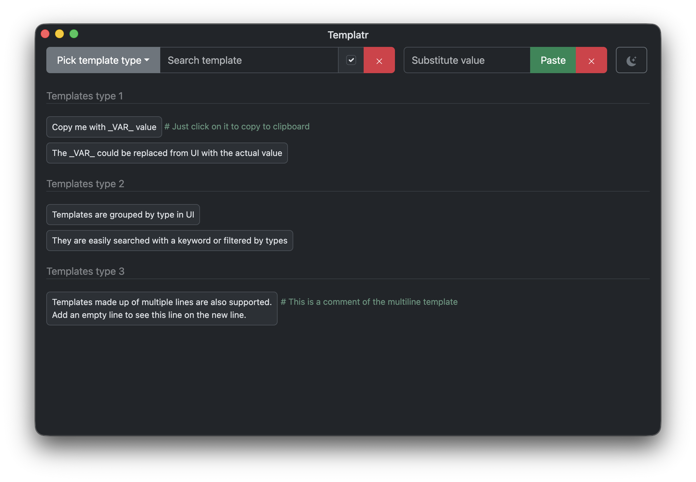

# Templatr

Templatr is a generic templating application built with Electron and React for a quick copy & paste action with easy to search templates maintained in YAML format and with support for comments.

1. First install dependencies: ```npm install```
2. To start Electron app in DEV mode: ```npm start```
3. Run ```npm run make``` to package application for Mac (for the architecture of the current machine)

To build for a specific Mac architecture, use one of the following (DMGs are written to `out/make`):

| Command | Output | Runs on |
| --- | --- | --- |
| `npm run make:mac-universal` | `Templatr_vX.Y.Z_universal.dmg` | Both Intel and Apple silicon (larger download) |
| `npm run make:mac-arm64` | `Templatr_vX.Y.Z_arm64.dmg` | Apple silicon (M1 and newer) |
| `npm run make:mac-x64` | `Templatr_vX.Y.Z_x64.dmg` | Intel |
| `npm run make:mac-all` | All three of the above | |

All targets can be built from either an Intel or an Apple silicon Mac.

To add templates, select "Edit Templates" from the menu to open the default YAML editor. Add your one-line or multi-line templates. The templates could be accompanied by standard YAML comments, which will be conveyed to UI as well. Add `_VAR_` to the templates whenever you need to be flexible with values. They could be easily replaced with actual value from UI. Once saved, restart the application (could be achieved from "Relaunch App" menu).

The substitute values themselves could be optionally saved as a YAML list for a quick `_VAR_` substitution. To create such a list, select "Edit Substitutes List", and restart the application on completion. Once created, the substitute values will be present in the dropdown box under "Substitute value" if the match found when starting to type. You still can use any string as `_VAR_` substitution even if it is not in the substitute values list. It gives the flexibility of using either the predefined value or a custom one typed or pasted from the clipboard.

Example of templates configuration:

```yaml
Templates type 1:
    - Copy me with _VAR_ value # Just click on it to copy to clipboard
    - The _VAR_ could be replaced from UI with the actual value
Templates type 2:
    - Templates are grouped by type in UI
    - They are easily searched with a keyword or filtered by types
Templates type 3:
    - "Templates made up
      of multiple lines are also supported.
      
      Add an empty line to see this line on the new line. # This is a comment of the multiline template
```

The current version has only been created with macOS in mind.


